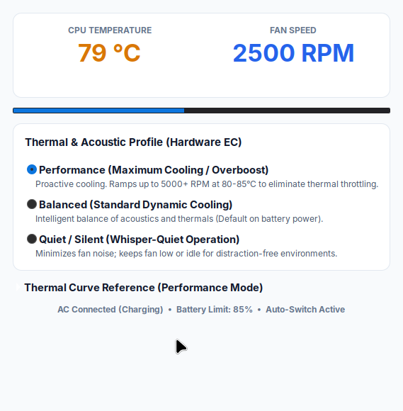

# 🚀 Linux Optimization Suite for ASUS Laptops

[](https://kernel.org)
[](https://www.asus.com)
[](https://www.python.org)
[](https://www.gtk.org)
[](LICENSE)
[](https://github.com/boburhasanov/linux-optimization)

A lightweight, production-grade optimization suite and graphical management center designed specifically for ASUS laptops running Linux (Linux Mint, Ubuntu, Debian, Cinnamon, GNOME). 

Engineered with a strict **Zero-Resource Background Policy**: no heavy polling daemons, no CPU wakeups, and no battery-draining loops. All hardware interactions are handled natively via kernel `sysfs`, event-driven `udev` triggers, and responsive GTK3 interfaces.

---

## 📸 Screenshots

| ❄️ ASUS Thermal & Cooling Center | 🔋 Battery Health & Charge Limiter |
| :---: | :---: |
|  |  |

---

## ✨ Features

### 1. ❄️ ASUS Thermal & Cooling Center (`asus-fan-gui`)
- **Real-Time Telemetry:** Live CPU package temperature and cooling fan RPM readings.
- **Hardware Fan Profiles:** Instant 1-click switching between ASUS firmware fan curves:
  - 🍃 **Quiet (Silent):** Minimal acoustic noise, optimized fan profile for office and reading.
  - ⚖️ **Balanced (Standard):** Dynamic curve responding to workload demands.
  - ⚡ **Performance (Overboost):** Aggressive thermal dissipation for compiling, gaming, and heavy computing.
- **Visual Status Badges:** Dynamic color-coded indicators for hardware health and profile status.

### 2. 🔋 Battery Health & Charge Threshold (`bat-limit-gui` & `bat-limit`)
- **Hardware Protection:** Configures ASUS hardware charge threshold (`charge_control_end_threshold`) to stop charging at **60%**, **80%** (default, recommended), or **100%** — or any value from 40–100 via the CLI.
- **Real Battery Health:** Shows live health (full vs. design capacity), cycle count and power draw read straight from the kernel.
- **Password Dialog, Not a Terminal:** The GUI applies changes through `pkexec` with its own polkit policy, so it works from the app menu.
- **Prolonged Lifespan:** Protects lithium-ion battery chemistry against degradation when plugged in for long periods.
- **Dual Interface:** Accessible via an intuitive desktop GUI or a fast CLI utility (`bat-limit`).
- **Persistence Across Reboots & Sleep:** The chosen limit is stored in a single file, `/etc/asus-battery-limit.conf`, and re-applied by a systemd unit (boot + resume) and a udev rule (battery add) — it survives reboot, suspend and hibernate.

### 3. ⚡ Zero-Resource Event-Driven Power Switcher
- Automatically shifts desktop power profiles between **Performance** and **Balanced** when the AC adapter is plugged in or unplugged.
- Powered entirely by kernel **udev events** (`98-powerprofile-switch.rules`) — absolutely zero background daemons consuming CPU cycles. Works with any mains adapter name (`AC0`, `ACAD`, `ADP1` …).

### 4. 🚀 Storage I/O Responsiveness
- Picks the lowest-latency I/O scheduler per device: `none` for NVMe, `mq-deadline` for SATA SSD / eMMC, `bfq` for spinning HDDs.
- Eliminates desktop micro-stutter during background file operations and heavy package upgrades.

### 5. 🧠 zram Compressed Swap
- Adds a zstd-compressed swap device in RAM (half of RAM, max 8 GB) via `systemd-zram-generator`, used before any disk swap.
- Tuned `vm.swappiness` / `page-cluster` / watermark values (as used by Fedora, Pop!_OS and ChromeOS): fewer SSD writes and no stalls under memory pressure.
- Optional — skip it with `sudo ./install.sh --no-zram`.

### 6. 🔬 Experimental: ASUS ELAN7001 Fingerprint Reader
- Complete hardware enablement guide, SPI udev rules, buffer configurations, and SIGFM patch for **ASUS ELAN SPI sensors** (`04f3:3104` / `ELAN7001` / `eFSA80SC`).
- 📖 [Read the complete Fingerprint Guide & Patch Walkthrough](experimental/fingerprint/README.md)

---

## 📂 Repository Structure

```text
linux-optimization/
├── README.md               # Documentation and usage guide
├── LICENSE                 # MIT License
├── install.sh              # Automated one-step system installer
├── uninstall.sh            # Complete uninstallation script
├── assets/                 # UI screenshots and documentation images
│   ├── fan_control.png
│   └── battery_limiter.png
├── experimental/           # Experimental hardware modules & research
│   └── fingerprint/        # ASUS ELAN7001 / 04f3:3104 SPI driver & SIGFM patch
├── bin/                    # Core executable utilities
│   ├── asus-fan-gui        # Thermal monitoring and profile switcher (GTK3)
│   ├── bat-limit-gui       # Battery threshold configuration GUI (GTK3)
│   ├── bat-limit           # Battery threshold CLI tool (Bash)
│   ├── asus-battery-apply  # Applies the saved limit (used by systemd/udev)
│   └── auto-powerprofile   # Event-driven AC/Battery switcher
├── desktop/                # System application menu integrations (.desktop)
│   ├── asus-fan-control.desktop
│   └── bat-limit.desktop
├── polkit/                 # Password-dialog policy for the battery GUI
│   └── io.github.boburhasanov.bat-limit.policy
├── zram/                   # Compressed RAM swap configuration
│   └── zram-generator.conf
├── sysctl/                 # Memory tuning for zram
│   └── 99-zram-tuning.conf
├── systemd/                # Persistence unit files
│   └── asus-battery-charge-threshold.service
└── udev/                   # Kernel hardware event rules
    ├── 60-ioscheduler.rules
    ├── 98-powerprofile-switch.rules
    └── 99-asus-battery-charge-threshold.rules
```

---

## 📥 Installation

Clone the repository and run the automated installer:

```bash
# 1. Clone repository
git clone https://github.com/boburhasanov/linux-optimization.git
cd linux-optimization

# 2. Run installer with sudo
sudo ./install.sh
```

The installer will automatically:
1. Copy executable binaries to `/usr/local/bin/`
2. Save the default 80% charge limit to `/etc/asus-battery-limit.conf`
3. Install the polkit policy and `.desktop` entries
4. Enable the persistent systemd battery service
5. Reload kernel `udev` hardware rules
6. Set up zram compressed swap (unless `--no-zram`)

---

## 🖥️ Usage

### Graphical Interface (GUI)
Simply search your application menu for:
- **ASUS Thermal & Cooling Center**
- **Battery Health Limiter**

Or launch them directly from your terminal:
```bash
asus-fan-gui &
bat-limit-gui &
```

### Command Line (CLI)
Query or change the battery charge limit directly:
```bash
# Check current battery limit
bat-limit

# Set battery charge limit to 80% (saved permanently)
sudo bat-limit 80
```

---

## 🧹 Uninstallation

To completely remove all installed scripts, systemd units, zram config and desktop shortcuts (charging is restored to 100%):

```bash
sudo ./uninstall.sh
```

---

## ✅ Tested On

| Laptop | OS | Kernel |
| --- | --- | --- |
| ASUS Vivobook 14 X1402ZA (Alder Lake) | Ubuntu 26.04 LTS (GNOME, Wayland) | 7.0 |
| ASUS laptops | Linux Mint (Cinnamon) | — |

---

## 👤 Author

**Bobur Hasanov**
- GitHub: [@boburhasanov](https://github.com/boburhasanov)

## 📄 License

This project is licensed under the MIT License - see the [LICENSE](LICENSE) file for details.
